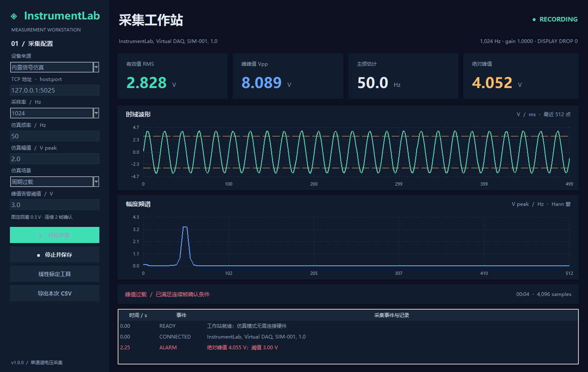
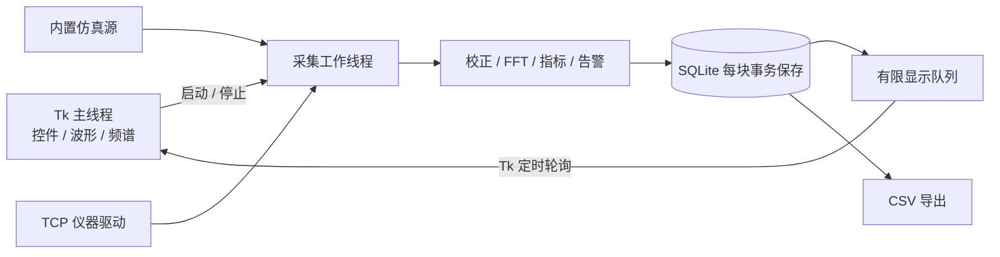

# InstrumentLab · 智能仪器采集与分析平台

**面向智能仪器、测试测量上位机岗位的 Python 桌面项目。** 从仪器连接、连续采集到信号分析、告警、标定和数据落盘，提供一个无需硬件即可复现的完整流程。

Python 3.10+ · Tkinter · TCP Socket · FFT · SQLite · 标准库运行，无第三方运行依赖

[GitHub 仓库](https://github.com/perceivedreality11-cyber/instrumentlab) · [自动化测试](https://github.com/perceivedreality11-cyber/instrumentlab/actions)



## 快速运行

在项目目录打开终端：

```bash
python -m instrumentlab --demo
```

Windows 也可双击 `start.cmd`。演示会自动启动周期过载场景，约 2.25 秒出现告警事件。点击「停止并保存」后可以导出 CSV。

需要带 Tk 支持的 Python。若 `python -m tkinter` 无法打开测试窗口，请在 Python 安装器中添加 Tcl/Tk；部分 Linux 发行版需安装系统包 `python3-tk`。命令行模式不依赖 Tk 和图形桌面。

```bash
# 无界面采集与导出
python -m instrumentlab --headless --seconds 5 --scenario overload --csv data/demo.csv

# 自动化测试
python -m unittest discover -s tests -v
```

## 可以展示什么

| 能力 | 实现 |
| --- | --- |
| 仪器接入 | 可复现的内置仿真源 + 真实 TCP Socket 驱动 + 独立 TCP 仿真仪器进程 |
| 实时采集 | 单通道，512 / 1024 / 2048 / 4096 Hz，固定 256 点/块 |
| 时域分析 | 最近 512 点波形、RMS、绝对峰值、峰峰值、均值、峰值因数 |
| 频域分析 | 基 2 FFT、去均值、Hann 窗、单边幅度谱、主频插值估计 |
| 状态提示 | 峰值过载告警；块均值和峰值因数规则提示 |
| 告警抗抖 | 连续 2 帧确认，0.3 V 回差，触发/恢复事件分别记录 |
| 线性标定 | 至少两组参考点，最小二乘拟合增益/偏置，展示拟合残差 |
| 数据追溯 | 每次采集独立 SQLite；保存配置、设备 ID、原始值、校正值、指标与告警 |
| 数据导出 | 带 BOM 的 UTF-8 CSV，逐采样点时间、原始电压、校正电压、块号与告警状态 |
| 工程实现 | 采集线程隔离、有限显示队列、连接超时、协议校验、错误反馈、自动化测试与 CI 配置 |

这里的“智能”指规则分析和自动化测量流程；本项目没有训练机器学习模型。

## 三分钟演示

1. 运行 `python -m instrumentlab --demo`，说明当前数据来自 **Virtual DAQ**。
2. 观察约 50 Hz 的主频、波形与频谱；默认幅值 2 V 时 RMS 约为 1.414 V。有限采样块和噪声会使数值小幅波动。
3. 约 2 秒后仿真幅值加倍，满足连续帧条件后产生 `ALARM`。约 6 秒后信号恢复，产生 `RECOVERED`。
4. 停止采集，导出 CSV，查看逐点数据和 `alarm` 列。
5. 打开「线性标定工具」，使用测量值 `0.02, 1.02, 2.02`，参考值 `0, 1, 2`，得到增益约 1、偏置约 -0.02 V。设置在下一次采集中生效并随录制保存。
6. 切换「三次谐波」或「零点漂移」，解释频谱与块均值的变化。

每次采集的时间从 0 开始；运行中锁定参数，避免一条录制混用不同采样配置。标定参数保留在当前应用进程中，不自动跨应用启动加载。

## TCP 通信演示

终端 A：启动一个独立的仿真设备进程。

```bash
python -m instrumentlab.mock_server --port 5025 --scenario overload
```

终端 B：

```bash
python -m instrumentlab --headless --tcp 127.0.0.1:5025 --seconds 8 --csv data/tcp.csv
```

也可以在界面选择「TCP 仪器」，填写 `127.0.0.1:5025`，采样率保持为 1024 Hz 后开始采集。TCP 模式下，信号频率、幅值、场景由服务端决定；界面里的仿真设置只影响内置仿真源。服务器重启或异常断开后，停止本次采集，再手动连接。

TCP 使用项目自定义的 **SCPI 风格文本子集**，含 `*IDN?`、`ACQ:CONF?` 和 `MEAS:WAV?`。**尚未验证任何品牌的真实仪器**，不能直接宣称通用 SCPI 兼容。真实示波器通常需要另写波形前导码、二进制块和量程换算适配，见[协议说明](docs/protocol.md)。

## 架构



所有采样块先写入数据库，再进入显示队列。界面跟不上时只丢弃旧的显示帧；数据库保留已经成功采集并处理的所有块。磁盘写入速度仍会限制采集能力，不能据此承诺硬实时或设备端永不丢样。

```text
instrumentlab/
├── instrumentlab/
│   ├── config.py          # 采集参数与校验
│   ├── drivers.py         # 仿真 / TCP 驱动
│   ├── analysis.py        # FFT、测量指标、告警、标定
│   ├── engine.py          # 采集线程与显示队列
│   ├── storage.py         # SQLite 与 CSV
│   ├── mock_server.py     # 独立 TCP 仿真设备
│   ├── ui.py              # Tkinter 桌面界面
│   └── __main__.py        # GUI / CLI 入口
├── tests/                 # 算法及 TCP / 录制集成测试
├── docs/                  # 协议、设计、面试讲解、截图
├── tools/gui_smoke.py     # 桌面操作流程验证
└── .github/workflows/     # GitHub Actions 配置
```

更多资料：[设计与取舍](docs/architecture.md) · [通信协议](docs/protocol.md) · [验证记录](docs/validation.md) · [面试讲解](docs/interview.md) · [上传 GitHub](docs/github.md)

## 验证范围与边界

- 已在本机 Windows / Python 3.14 验证核心测试、命令行采集导出，以及真实 Tk 窗口的采集、过载、停止、重启和最小窗口布局。
- GitHub Actions 已配置 Windows / Ubuntu 与 Python 3.10 / 3.12 / 3.14 矩阵；远端执行结果以仓库 Actions 页面为准。
- FFT 输入为 256 点，频率间隔为 `sample_rate / 256`。主频插值估计不等同于提升物理频率分辨率；频谱峰值也会受非整周期采样影响。
- 支持单通道电压；没有串口、Modbus、VISA、硬件触发、实时操作系统或实机精度验证。标定残差是对所给点的拟合误差，不是计量认证或测量不确定度。
- 状态分析采用阈值规则，可能出现误报；块均值会受截断正弦的影响。告警用于软件演示，不用于安全联锁。
- 默认 TCP 仿真服务器只绑定本机回环地址，没有认证或加密；不要把它直接作为公网服务部署。

## 许可

[MIT](LICENSE)
