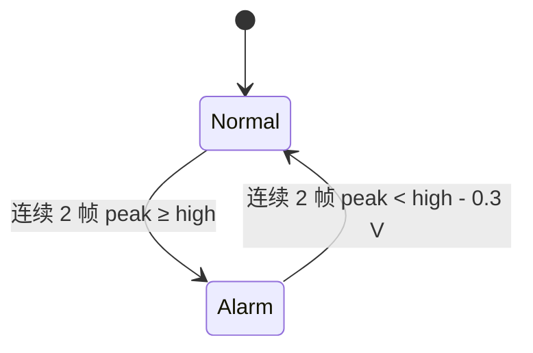

# 设计与工程取舍

## 线程和资源所有权

Tk 控件只能由主线程更新。采集线程负责设备连接、读取、标定、分析、告警和数据库写入，GUI 每 60 ms 轮询一次数据。停止操作只设置 `threading.Event`，不会在界面回调中阻塞等待网络连接。关闭窗口时等待采集线程清理资源，TCP 超时默认为 2 秒。

显示帧队列上限 8 帧。积压时丢弃队列最老帧，界面展示最新数据并显示 `DISPLAY DROP`。数据库写入发生在入队前，成功处理的块不会因显示队列满而丢失。连接、告警、错误消息使用单独队列传递；告警事件在 GUI 中最多保留 200 行，持久化告警事件不受这个限制。

这一设计优先保证桌面响应和录制的可解释性，没有单独的磁盘写入线程。若要支持高吞吐硬件，应引入设备缓存计数、独立写入队列、背压策略和端到端丢样检测。

## 数据路径

1. 仿真源以连续样点索引生成相位；TCP 驱动验证每块是 256 个有限数值。
2. 原始电压经 `corrected = raw × gain + offset` 校正。
3. 计算时域指标；去均值后乘 Hann 窗，执行 FFT，生成单边幅度谱。
4. 在非 DC 频点寻找最大值，用相邻频点的对数幅度抛物线插值估计主频。直流信号主频为 0。
5. 峰值进入告警状态机。
6. 块数据和对应告警转换事件在同一个 SQLite 事务写入。

没有反混叠滤波器或硬件 ADC。本地仿真限制基频小于 Nyquist 频率，三次谐波场景还要求三倍基频小于 Nyquist 频率。

## 测量定义

- RMS：`sqrt(mean(x²))`，包含直流分量。
- 绝对峰值：`max(abs(x))`。
- 峰峰值：`max(x) - min(x)`。
- 峰值因数：`peak / RMS`；零信号定义为 0。
- 幅度谱：去均值、Hann 加窗后，用窗函数总和校正相干增益；正频率非 Nyquist 项乘 2。纵轴单位为 V peak，不是功率谱密度。
- 线性标定：对“测量值 → 参考值”做最小二乘拟合，仅支持正增益，报告标定点残差 RMSE。

## 告警状态机

中途不满足条件会清零连续计数。告警状态内的回差带防止阈值附近反复触发。默认 1024 Hz、256 点/块时，一块为 250 ms，两帧确认带来约 0.25–0.5 秒的检测延迟，具体还与块内峰值位置有关。该机制不能替代硬件保护。

## 数据模型

每次采集使用 UTC 文件名和随机后缀创建独立文件，拒绝复用现有路径。

| 表 | 内容 |
| --- | --- |
| metadata | schema_version、完整配置 JSON、设备 ID |
| blocks | seq、start_s、原始采样 JSON、校正采样 JSON、指标 JSON、告警状态 |
| events | 对应块号、相对时间、ALARM/RECOVERED、峰值详情 |

CSV 包含 `time_s, raw_voltage_v, voltage_v, block, alarm`。时间按样点索引/采样率计算，是会话相对时间；TCP 协议没有设备时间戳，所以不能声称多设备时钟同步。导出使用只读 SQLite 连接，关闭连接后即可移动或删除录制文件。

## 为什么先采用标准库

减少求职作品的安装阻力，使算法、线程模型和协议处理可以直接阅读。基 2 FFT 复杂度为 O(N log N)，适合当前演示规模；升级到多通道或更长波形时，可替换为 NumPy / SciPy，并用现有直接 DFT 对照测试保持数值一致性。

## 后续可实施的扩展

1. 根据一台具体仪器的编程手册实现实机驱动，并录制真实测试证据。
2. 在协议中加入块序号、设备时间戳、量程和单位，验证设备侧丢样。
3. 加入多通道、录制回放、设备重连策略和配置文件。
4. 用真实故障标签评估异常检测模型，再报告误报率与漏报率。
